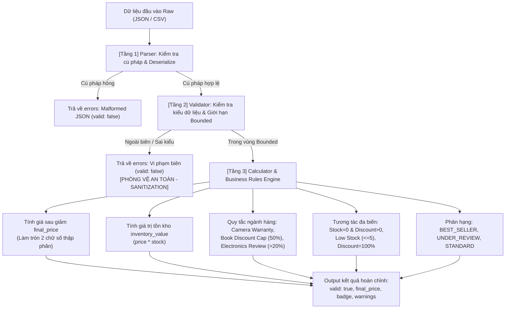

# Product Analyzer Fuzz Testing & SAT Invariant Verification

[](https://www.python.org/)
[-brightgreen.svg)](tests/)
[](htmlcov/index.html)
[-orange.svg)](app.py)
[](#)

---

## Mục lục (Table of Contents)

- [Mô tả dự án](#mô-tả-dự-án)
- [Bắt đầu nhanh](#bắt-đầu-nhanh)
- [1. Chức năng chính & Đường ống xử lý](#1-chức-năng-chính--đường-ống-xử-lý)
  - [1.1. Từ điển dữ liệu & Đặc tả Schema (Data Dictionary)](#11-từ-điển-dữ-liệu--đặc-tả-schema-data-dictionary)
  - [1.2. Đường ống xử lý 3 tầng & Logic trong vùng Bounded](#12-đường-ống-xử-lý-3-tầng--logic-trong-vùng-bounded)
- [2. Ví dụ Input và Output](#2-ví-dụ-input-và-output)
- [3. Luồng hoạt động & Kiến trúc hệ thống](#3-luồng-hoạt-động--kiến-trúc-hệ-thống)
- [4. Cấu trúc thư mục dự án](#4-cấu-trúc-thư-mục-dự-án)
- [5. Cài đặt môi trường trên Windows](#5-cài-đặt-môi-trường-trên-windows)
- [6. Chạy bộ kiểm thử tự động & Đo độ phủ](#6-chạy-bộ-kiểm-thử-tự-động--đo-độ-phủ)
- [7. Hướng dẫn sử dụng Giao diện Desktop GUI & Menu CLI](#7-hướng-dẫn-sử-dụng-giao-diện-desktop-gui--menu-cli)
  - [7.1. Cấu trúc tổng thể của giao diện](#71-cấu-trúc-tổng-thể-của-giao-diện)
  - [7.2. Mô tả chi tiết 10 trường hợp mô phỏng trên GUI](#72-mô-tả-chi-tiết-10-trường-hợp-mô-phỏng-trên-gui)
  - [7.3. Cơ chế Loading trực quan khi chạy quy mô lớn (1.000 - 2.000+ inputs)](#73-cơ-chế-loading-trực-quan-khi-chạy-quy-mô-lớn-1000---2000-inputs)
- [8. Làm rõ kết quả VALID và INVALID khi chạy Fuzzing](#8-làm-rõ-kết-quả-valid-và-invalid-khi-chạy-fuzzing)
  - [8.1. Định nghĩa kỹ thuật chuẩn xác](#81-định-nghĩa-kỹ-thuật-chuẩn-xác)
  - [8.2. Tại sao INVALID là hành vi phòng vệ thành công của Validator?](#82-tại-sao-invalid-là-hành-vi-phòng-vệ-thành-công-của-validator)
  - [8.3. Bảng phân loại toàn diện của Test Oracle](#83-bảng-phân-loại-toàn-diện-của-test-oracle)
- [9. Giải thích chi tiết kết quả chạy các kiểm thử (Fuzzing & Memory)](#9-giải-thích-chi-tiết-kết-quả-chạy-các-kiểm-thử-fuzzing--memory)
  - [9.1. So sánh kết quả Black-box Fuzzing vs White-box Fuzzing](#91-so-sánh-kết-quả-black-box-fuzzing-vs-white-box-fuzzing)
  - [9.2. Giải thích kết quả Mô hình bộ nhớ theo chuẩn CWE (SAFE, BLOCKED, DETECTED)](#92-giải-thích-kết-quả-mô-hình-bộ-nhớ-theo-chuẩn-cwe-safe-blocked-detected)
- [10. Mô phỏng các trường hợp sinh lỗi & Tìm kiếm phản ví dụ SAT (SAT-Guided Fuzzing)](#10-mô-phỏng-các-trường-hợp-sinh-lỗi--tìm-kiếm-phản-ví-dụ-sat-sat-guided-fuzzing)
  - [10.1. Cơ sở lý thuyết: Bài toán SAT & Phản ví dụ trong Kiểm chứng phần mềm](#101-cơ-sở-lý-thuyết-bài-toán-sat--phản-ví-dụ-trong-kiểm-chứng-phần-mềm)
  - [10.2. Các Bất biến hệ thống và Phản ví dụ SAT tương ứng](#102-các-bất-biến-hệ-thống-và-phản-ví-dụ-sat-tương-ứng)
  - [10.3. Mô phỏng Crash runtime & Lỗi bộ nhớ nghiêm trọng](#103-mô-phỏng-crash-runtime--lỗi-bộ-nhớ-nghiêm-trọng)
  - [10.4. Hướng dẫn thực thi mô phỏng lỗi](#104-hướng-dẫn-thực-thi-mô-phỏng-lỗi)
- [11. Hướng dẫn tái hiện lỗi độc lập (`reproduce_crash.py`)](#11-hướng-dẫn-tái-hiện-lỗi-độc-lập-reproduce_crashpy)
- [12. Tài liệu báo cáo kèm theo](#12-tài-liệu-báo-cáo-kèm-theo)

---

## Mô tả dự án

**Product Analyzer Fuzz Testing & SAT Invariant Verification** là đồ án môn học An toàn phần mềm / Kiểm thử phần mềm, mô phỏng quy trình kiểm thử độ tin cậy, tính đúng đắn và an toàn của một thành phần xử lý dữ liệu sản phẩm trong hệ thống thương mại điện tử. Chương trình nhận dữ liệu sản phẩm ở định dạng JSON hoặc CSV, xác thực trường dữ liệu và kiểu, kiểm tra các giới hạn biên và quy tắc nghiệp vụ, sau đó tính toán giá sau giảm, giá trị tồn kho và phân hạng sản phẩm.

Dự án kết hợp bốn trụ cột kiểm thử tiên tiến:
1. **Black-box Fuzzing (Kiểm tra biên BVA):** Coi hệ thống như hộp đen, áp dụng Phân tích giá trị biên (Boundary Value Analysis - BVA) và Đột biến (Mutation) để kiểm tra xem hệ thống có bảo vệ và từ chối đúng các giá trị nằm ngoài vùng xác định (**Bounded Region**) hay không.
2. **White-box Fuzzing (Đào sâu logic Bounded theo độ phủ):** Biết mã nguồn hệ thống, ưu tiên sinh dữ liệu hợp lệ trong vùng Bounded và dùng công cụ `coverage.py` để giữ lại input làm tăng số dòng mã analyzer được thực thi (`coverage_points`).
3. **Mô hình An toàn Bộ nhớ Python (Phân loại theo chuẩn CWE):** Mô phỏng an toàn bằng Python các điều kiện bộ nhớ mức thấp (tràn buffer stack, tràn số nguyên, rò rỉ bộ nhớ, giải phóng hai lần, sử dụng sau giải phóng, con trỏ NULL), phân loại theo 3 trạng thái `SAFE`, `BLOCKED`, `DETECTED`.
4. **Kiểm chứng hình thức SAT & Tìm kiếm phản ví dụ (SAT-Guided Fuzzing):** Ứng dụng lý thuyết kiểm chứng hình thức: tìm kiếm đầu vào $x^*$ thỏa mãn bài toán $\text{SAT}(\neg \text{Invariant})$, tự động phát hiện phản ví dụ chứng minh sự tồn tại của lỗi logic nghiệp vụ, vi phạm bất biến tài chính hoặc lỗi ngoại lệ runtime unhandled.

Toàn bộ kết quả được hiển thị bằng **100% Tiếng Việt** trên giao diện Desktop GUI đa luồng (hỗ trợ hiển thị thanh tiến trình Loading khi chạy quy mô lớn 1.000 - 2.000+ inputs), xuất ra 6 tệp báo cáo CSV chi tiết và 6 biểu đồ trực quan.

---

## Bắt đầu nhanh

Mở PowerShell tại thư mục dự án, sau đó chạy:

```powershell
python --version
python -m venv .venv
.\.venv\Scripts\Activate.ps1
python -m pip install --upgrade pip
python -m pip install -r requirements.txt
python -m pytest
python app.py
```

Kết quả mong đợi: toàn bộ **57 tests** kết thúc thành công (**100% PASS**, độ phủ **93%**) và cửa sổ **Product Analyzer | Fuzz Lab** mở ra với giao diện tiếng Việt hoàn chỉnh.

---

## 1. Chức năng chính & Đường ống xử lý

### 1.1. Từ điển dữ liệu & Đặc tả Schema (Data Dictionary)

Hệ thống quản lý bản ghi sản phẩm chuẩn thông qua đặc tả tường minh tại [`analyzer/schema.py`](file:///d:/ATPM/analyzer/schema.py):

| Trường (Field) | Bắt buộc | Kiểu dữ liệu | Giới hạn kích cỡ / Vùng Bounded | Ý nghĩa nghiệp vụ |
| :--- | :---: | :--- | :--- | :--- |
| `id` | Có | `string` | Không được rỗng hoặc chỉ có khoảng trắng | Mã định danh duy nhất của sản phẩm |
| `name` | Có | `string` | Không rỗng; độ dài tối đa 100 ký tự | Tên thương mại của sản phẩm |
| `category` | Có | `string` | Phải là chuỗi ký tự hợp lệ | Danh mục ngành hàng |
| `price` | Có | `float` / `int` | Không âm ($price \ge 0$); cảnh báo nếu $> 10^{12}$ | Đơn giá niêm yết (VNĐ) |
| `stock` | Có | `int` | Không âm ($stock \ge 0$); cảnh báo nếu $> 1.000.000$ | Số lượng sản phẩm tồn kho |
| `discount` | Có | `float` / `int` | $0.0 \le \text{discount} \le 100.0$ (%) | Tỷ lệ chiết khấu giảm giá |
| `rating` | Có | `float` / `int` | $0.0 \le \text{rating} \le 5.0$ (thang điểm 5 sao) | Điểm đánh giá chất lượng trung bình |
| `description` | Không | `string` / `null` | Tối đa 1.000 ký tự; vượt quá chỉ tạo cảnh báo | Thông tin mô tả chi tiết tính năng |

### 1.2. Đường ống xử lý 3 tầng & Logic trong vùng Bounded

Một bản ghi nạp vào được xử lý qua 3 tầng độc lập:

1. **Tầng 1 - Parser (`analyzer/parser.py`):** Đọc chuỗi JSON hoặc CSV một sản phẩm. Chuyển đổi cú pháp, bắt các lỗi định dạng và ném `InputParseError` nếu cú pháp méo mó.
2. **Tầng 2 - Validator (`analyzer/validator.py`):** Kiểm tra trường bắt buộc, kiểu dữ liệu, các giới hạn biên và các ngưỡng cảnh báo. Nếu vi phạm, ghi nhận vào mảng `errors` và đánh dấu `valid = False`; cảnh báo nghiệp vụ được ghi vào `warnings` và không làm bản ghi mất tính hợp lệ.
3. **Tầng 3 - Calculator (`analyzer/product_analyzer.py`):** Khi bản ghi hợp lệ (`errors` rỗng), hệ thống đào sâu vào các nhánh logic nội bộ trong vùng Bounded:
   - **Tính toán tài chính & làm tròn tiền tệ:**
     - Giá sau giảm: $\text{final\_price} = \text{round}(price \times (1 - \frac{discount}{100}), 2)$ (tránh sai số làm tròn số thực Floating-point).
     - Giá trị tồn kho: $\text{inventory\_value} = price \times stock$.
   - **Nhánh tương tác đa biến (Inter-field constraints):**
     - Cảnh báo sản phẩm hết hàng nhưng vẫn cài đặt giảm giá ($stock = 0 \land discount > 0$).
     - Cảnh báo tồn kho sắp hết ($0 < stock \le 5$).
   - **Nhánh chính sách ngành hàng:**
     - Thiết bị điện tử giá cao ($price \ge 10.000.000$ đ) giảm giá $> 20\%$ phải yêu cầu quản lý phê duyệt.
     - Sách (`category == "Book"`) không được vượt trần chiết khấu của nhà xuất bản ($discount > 50\%$).
     - Cảnh báo sản phẩm ngành `Camera` nên kèm thông tin bảo hành.
   - **Nhánh giảm giá 100%:** Cảnh báo sản phẩm tặng kèm miễn phí ($0$ đồng).
   - **Nhánh phân hạng sản phẩm (`badge`):**
     - `BEST_SELLER`: Sản phẩm bán chạy ($rating \ge 4.5 \land stock > 10$).
     - `UNDER_REVIEW`: Sản phẩm cần xem xét / khiếu nại ($rating < 2.0$).
     - `STANDARD`: Sản phẩm tiêu chuẩn.

---

## 2. Ví dụ Input và Output

### 2.1. Bản ghi hợp lệ trong vùng Bounded

Input JSON:
```json
{
  "id": "P001",
  "name": "Camera Wifi",
  "category": "Camera",
  "price": 1500000,
  "stock": 20,
  "discount": 10,
  "rating": 4.5,
  "description": "Camera giam sat wifi"
}
```

Output JSON tương ứng:
```json
{
  "valid": true,
  "final_price": 1350000.0,
  "inventory_value": 30000000,
  "average_rating": 4.5,
  "badge": "BEST_SELLER",
  "errors": [],
  "warnings": [
    "Camera products should include a warranty description"
  ]
}
```

### 2.2. Bản ghi ngoài biên (Bị Validator từ chối an toàn)

Input JSON vi phạm nhiều biên:
```json
{
  "id": "P_INVALID",
  "name": "Invalid Product",
  "category": "Camera",
  "price": -500000,
  "stock": -5,
  "discount": 120,
  "rating": 6.5
}
```

Output JSON tương ứng:
```json
{
  "valid": false,
  "final_price": null,
  "inventory_value": null,
  "average_rating": null,
  "errors": [
    "Price must not be negative",
    "Stock must not be negative",
    "Discount must be between 0 and 100",
    "Rating must be between 0 and 5"
  ],
  "warnings": []
}
```

---

## 3. Luồng hoạt động & Kiến trúc hệ thống



---

## 4. Cấu trúc thư mục dự án

```text
ATPM/
├── analyzer/                  # Bộ phân tích sản phẩm (Target System)
│   ├── schema.py              # Đặc tả Data Dictionary và giới hạn vùng Bounded
│   ├── parser.py              # Đọc và chuyển đổi cú pháp JSON/CSV
│   ├── validator.py           # Kiểm tra kiểu và quy tắc biên sơ cấp
│   ├── product_analyzer.py    # Điều phối, tính toán và các nhánh nghiệp vụ sâu
│   └── faulty_analyzer.py     # Bộ mô phỏng lỗi logic & ngoại lệ phục vụ SAT Fuzzing
├── fuzzing/                   # Các bộ Fuzzing và kiểm chứng hình thức
│   ├── generators.py          # Bộ sinh test biên (BVA) và test sâu trong Bounded
│   ├── mutations.py           # Biến đổi đột biến input (Bit flip, shuffle, insert)
│   ├── blackbox_fuzzer.py     # Black-box executor và Oracle phân loại
│   ├── whitebox_fuzzer.py     # Coverage-guided fuzzer đào sâu vùng Bounded
│   ├── memory_model.py        # Mô phỏng các tình huống bộ nhớ bằng Python
│   ├── memory_fuzzer.py       # Fuzzer cho memory model và báo cáo CWE
│   └── sat_fuzzer.py          # SAT Fuzzer tìm phản ví dụ & mô phỏng crash runtime
├── tests/                     # 57 Unit Tests tự động (Pytest)
│   ├── test_normal.py         # Test sản phẩm hợp lệ và JSON sai cú pháp
│   ├── test_boundary.py       # Test các giá trị biên ngoài (BVA)
│   ├── test_data_dictionary.py # Test tính đầy đủ của Data Dictionary và Schema
│   ├── test_bounded_whitebox.py # Test các nhánh nghiệp vụ sâu bên trong vùng Bounded
│   ├── test_regression.py     # Test hồi quy sai kiểu và đọc CSV
│   ├── test_python_memory_model.py # Test kết quả mô phỏng CWE
│   ├── test_memory_fuzzer.py   # Test memory-model fuzzer
│   └── test_sat_counterexamples.py # Test kiểm chứng SAT, phản ví dụ & crash simulation
├── crashes/                   # Thư mục lưu vết finding / crash tự động
│   ├── blackbox/              # Lỗi tìm thấy từ black-box
│   ├── whitebox/              # Lỗi tìm thấy từ white-box
│   ├── sat_counterexamples/   # Các phản ví dụ vi phạm bất biến SAT (JSON)
│   ├── runtime_crashes/       # Các ca crash runtime unhandled (JSON)
│   └── memory_faults/         # Các ca lỗi bộ nhớ nghiêm trọng (JSON)
├── reports/                   # Báo cáo thực nghiệm
│   ├── blackbox_results.csv   # Kết quả phân loại từng lượt chạy Black-box
│   ├── whitebox_results.csv   # Điểm độ phủ coverage_points qua từng iteration
│   ├── memory_results.csv     # Phân loại trạng thái bộ nhớ và mã CWE
│   ├── sat_fuzzing_results.csv # Báo cáo chi tiết các phản ví dụ SAT tìm được
│   ├── crash_simulation_results.csv # Báo cáo các ca unhandled crash runtime
│   ├── unsafe_memory_results.csv # Báo cáo các ca sập bộ nhớ ở chế độ Unsafe
│   ├── summary.json           # Thống kê tổng hợp số lượng của lần chạy gần nhất
│   └── charts/                # 6 biểu đồ PNG trực quan
├── app.py                     # Giao diện Desktop GUI (Tkinter 100% Tiếng Việt, đa luồng)
├── main.py                    # Menu CLI mở rộng hỗ trợ 10 chế độ tương tác terminal
├── experiment.py              # Kịch bản chạy thực nghiệm tự động
├── reporting.py               # Tổng hợp số liệu và render 6 biểu đồ trực quan (Matplotlib Agg)
├── reproduce_crash.py         # Script nạp và tái hiện độc lập bất kỳ file finding/crash nào
├── requirements.txt           # Thư viện phụ thuộc
├── REPORT.md                  # Khung báo cáo đồ án chi tiết 7 chương
├── HUONG_DAN_BAO_CAO_DEMO.md  # Cẩm nang thuyết trình, demo và bộ câu hỏi Q&A phản biện
└── SLIDES.md                  # Dàn ý slide thuyết trình
```

---

## 5. Cài đặt môi trường trên Windows

Mở PowerShell tại thư mục dự án:

```powershell
python --version
python -m venv .venv
.\.venv\Scripts\Activate.ps1
python -m pip install --upgrade pip
python -m pip install -r requirements.txt
```

Nếu PowerShell chặn script kích hoạt môi trường ảo:
```powershell
Set-ExecutionPolicy -Scope Process -ExecutionPolicy RemoteSigned
.\.venv\Scripts\Activate.ps1
```

---

## 6. Chạy bộ kiểm thử tự động & Đo độ phủ

### 6.1. Chạy toàn bộ 57 bài kiểm thử

```powershell
.venv\Scripts\python.exe -m pytest
```
*Kết quả:* Toàn bộ **57 passed** trong khoảng 1.5 giây.

### 6.2. Đo độ bao phủ mã nguồn (Code Coverage)

```powershell
.venv\Scripts\python.exe -m coverage run -m pytest
.venv\Scripts\python.exe -m coverage report
.venv\Scripts\python.exe -m coverage html
```

Bảng tổng kết độ phủ:
```text
Name                                Stmts   Miss  Cover
-------------------------------------------------------
analyzer\faulty_analyzer.py            70     11    84%
analyzer\parser.py                     37      8    78%
analyzer\product_analyzer.py           45      0   100%
analyzer\schema.py                     15      0   100%
analyzer\validator.py                  59      9    85%
fuzzing\generators.py                 113      6    95%
fuzzing\memory_fuzzer.py               47     15    68%
fuzzing\memory_model.py                66      5    92%
fuzzing\mutations.py                   22      3    86%
fuzzing\sat_fuzzer.py                 233      7    97%
tests\...                             260      0   100%
-------------------------------------------------------
TOTAL                                 927     64    93%
```
Mở `htmlcov/index.html` trên trình duyệt để xem chi tiết từng dòng mã được bao phủ.

---

## 7. Hướng dẫn sử dụng Giao diện Desktop GUI & Menu CLI

### Khởi chạy giao diện Desktop:

```powershell
.venv\Scripts\python.exe app.py
```

### 7.1. Cấu trúc tổng thể của giao diện

```text
+--------------------------------------------------------------------------------------------------+
|                                  PRODUCT ANALYZER | FUZZ LAB                                     |
+--------------------------------------------------------------------------------------------------+
| [Tab 1: Phân tích sản phẩm] | [Tab 2: Phòng thí nghiệm fuzzing] | [Tab 3: Kết quả & biểu đồ]     |
+--------------------------------------------------------------------------------------------------+
| TAB 1: [Nạp ví dụ chuẩn]  [Chọn mẫu lỗi biên v]  [Nạp lỗi biên]  [Phân tích]                     |
|                                                                                                  |
| TAB 2: Số input: [1000]                                                                          |
| - Nhóm Chuẩn   : [Black-box (Biên BVA)] [White-box (Độ phủ)] [Mô hình bộ nhớ (CWE)] [Chạy toàn bộ]|
| - Nhóm Mô phỏng: [Phản ví dụ SAT (Lỗi Logic)] [Mô phỏng Crash] [Lỗi bộ nhớ nghiêm trọng]        |
| - Tiến trình   : [⏳ Đang thực thi mô phỏng: ... Vui lòng đợi...] [======== Progressbar ========] |
|                                                                                                  |
| TAB 3: Bảng CSV: [blackbox_results.csv v]  [Làm mới]  [Tạo biểu đồ trực quan]                    |
+--------------------------------------------------------------------------------------------------+
```

---

### 7.2. Mô tả chi tiết 10 trường hợp mô phỏng trên GUI

#### Trường hợp 1: Phân tích sản phẩm mẫu hợp lệ (Tab 1: Nút "Nạp ví dụ chuẩn")
* **Thao tác:** Bấm nút **"Nạp ví dụ chuẩn"**.
* **Cơ chế:** Nạp JSON chuẩn trong Bounded (`price: 1.500.000`, `stock: 20`, `discount: 10%`, `Camera`) và **tự động phân tích ngay**.
* **Kết quả:** Hiển thị `HỢP LỆ (VALID)`, tính giá sau giảm $1.350.000$ đ, tồn kho $30.000.000$ đ, gán nhãn `BEST_SELLER`, cảnh báo bổ sung bảo hành Camera.

#### Trường hợp 2: Mô phỏng từ chối dữ liệu ngoài biên (Tab 1: Menu chọn mẫu + Nút "Nạp lỗi biên")
* **Thao tác:** Chọn một trong 7 kịch bản lỗi trong hộp chọn rồi bấm **"Nạp lỗi biên"**:
  1. *Tổng hợp nhiều lỗi biên (Giá âm, Tồn kho âm, Discount > 100, Rating > 5)*
  2. *Lỗi đơn giá âm ($price = -1$)*
  3. *Lỗi chiết khấu vượt trần ($discount = 120\%$)*
  4. *Lỗi điểm đánh giá vượt trần ($rating = 6.0$ sao)*
  5. *Lỗi tên sản phẩm quá dài ($> 100$ ký tự)*
  6. *Lỗi số lượng tồn kho âm ($stock = -10$)*
  7. *Lỗi cú pháp JSON (Malformed Syntax)*
* **Cơ chế:** Nạp JSON lỗi và **tự động phân tích ngay**.
* **Kết quả:** Hiển thị `BẢN GHI KHÔNG HỢP LỆ (BỊ TỪ CHỐI / INVALID)`, liệt kê chính xác các lỗi biên bị chặn. Ứng dụng phòng vệ an toàn, không bị crash.

#### Trường hợp 3: Mô phỏng Black-box Fuzzing (Tab 2: Nút "Black-box (Biên BVA)")
* **Thao tác:** Đặt số input (100 - 10.000) và bấm nút.
* **Cơ chế:** Áp dụng BVA thăm dò các cận cực trị ngoài biên ($price = -1$, $discount = 100.01$, sai kiểu, JSON rách).
* **Kết quả:** `INVALID` chiếm đa số (~70% - 85%), `VALID` chiếm ~15% - 30%, Crashes = 0. Ghi vào `reports/blackbox_results.csv`.

#### Trường hợp 4: Mô phỏng White-box Fuzzing (Tab 2: Nút "White-box (Độ phủ Bounded)")
* **Thao tác:** Đặt số input và bấm nút.
* **Cơ chế:** Sử dụng `coverage.py` đo độ phủ dòng mã, sinh dữ liệu hợp lệ hướng vào các nhánh logic nội bộ (Book cap, Camera warranty, Electronics review, Badge).
* **Kết quả:** `VALID` chiếm đa số (~75% - 90%), số điểm độ phủ `coverage_points` đạt tối đa, kích thước Corpus tăng dần. Ghi vào `reports/whitebox_results.csv`.

#### Trường hợp 5: Mô phỏng An toàn Bộ nhớ theo CWE (Tab 2: Nút "Mô hình bộ nhớ (CWE an toàn)")
* **Thao tác:** Bấm nút để chạy mô hình bộ nhớ giả lập.
* **Cơ chế:** Kiểm tra 7 kịch bản thao tác tài nguyên mức thấp.
* **Kết quả:** Phân loại rõ `SAFE` (an toàn), `BLOCKED` (chặn trước CWE-121, 190, 476, 789, 20) và `DETECTED` (phát hiện lỗi sở hữu CWE-401, 415, 416). Ghi vào `reports/memory_results.csv`.

#### Trường hợp 6: Mô phỏng Chạy toàn bộ thí nghiệm chuẩn (Tab 2: Nút "Chạy toàn bộ chuẩn")
* **Thao tác:** Bấm nút màu cam nổi bật.
* **Cơ chế:** Chạy đồng thời cả 3 bộ Black-box, White-box, Memory Model với số lượng input đã chọn.
* **Kết quả:** Bảng tổng kết số liệu 3 phương pháp, tự động xuất `reports/summary.json` và vẽ lại biểu đồ.

#### Trường hợp 7: Mô phỏng Phản ví dụ SAT (Tab 2: Nút "Phản ví dụ SAT (Lỗi Logic)")
* **Thao tác:** Bấm nút màu đỏ chuyên dụng.
* **Cơ chế:** Chạy `SATFuzzer` giải bài toán $\text{SAT}(\neg \text{Invariant})$, tìm các đầu vào vi phạm 4 bất biến an toàn nghiệp vụ.
* **Kết quả:** `[!] PHÁT HIỆN LỖI LOGIC / PHẢN VÍ DỤ SAT: ... trường hợp`. Hiển thị chi tiết 5 phản ví dụ tiêu biểu (giá sau giảm tăng, giá âm do discount 150%, rating=0 gây chia cho 0). Lưu file JSON vào `crashes/sat_counterexamples/`.

#### Trường hợp 8: Mô phỏng Crash & Ngoại lệ Runtime (Tab 2: Nút "Mô phỏng Crash (Ngoại lệ Runtime)")
* **Thao tác:** Bấm nút màu đỏ chuyên dụng.
* **Cơ chế:** Chạy `CrashFuzzer` tiêm chuỗi null byte `\x00` (`RuntimeError`), payload tràn bộ nhớ ảo (`MemoryError`), lỗi giải mã JSON (`SystemError`).
* **Kết quả:** `[!] PHÁT HIỆN CRASH / UNHANDLED EXCEPTION: ... ca`. Ghi nhận thông điệp lỗi và lưu file crash JSON vào `crashes/runtime_crashes/`.

#### Trường hợp 9: Mô phỏng Lỗi bộ nhớ nghiêm trọng (Tab 2: Nút "Lỗi bộ nhớ nghiêm trọng (CWE Faults)")
* **Thao tác:** Bấm nút màu đỏ chuyên dụng.
* **Cơ chế:** Chạy `UnsafeMemoryFuzzer` ở chế độ Unsafe không có guard bảo vệ, kích hoạt Double-free (CWE-415) và Use-after-free (CWE-416).
* **Kết quả:** Nâng cấp thành `[!] LỖI BỘ NHỚ NGHIÊM TRỌNG (CRITICAL FAULT)`, mô phỏng crash tiến trình do phá hủy vùng nhớ. Lưu file JSON vào `crashes/memory_faults/`.

#### Trường hợp 10: Xem bảng kết quả CSV và Biểu đồ trực quan (Tab 3: "Kết quả & biểu đồ")
* **Thao tác:** Chọn file CSV trong hộp chọn $\rightarrow$ bảng hiển thị chi tiết từng dòng lặp. Bấm **"Tạo biểu đồ trực quan"** $\rightarrow$ xem trước 6 biểu đồ PNG trực quan.

---

### 7.3. Cơ chế Loading trực quan khi chạy quy mô lớn (1.000 - 2.000+ inputs)

Khi tăng số lượng input lên lớn (1.000, 2.000, 5.000 hoặc 10.000 inputs), các thuật toán Fuzzing (đặc biệt là White-box đo coverage) có thể mất vài giây đến vài chục giây để tính toán. Giao diện Desktop được trang bị cơ chế chỉ báo và thông báo hoàn thành hoàn toàn tự động:

1. **Trong lúc đang chạy (Loading):**
   - Con trỏ chuột chuyển sang dạng chờ (**`watch`**).
   - Biểu ngữ hiển thị: **`⏳ ĐANG THỰC THI MÔ PHỎNG: ... (X inputs)... Vui lòng đợi trong giây lát.`**
   - Thanh tiến trình **Progressbar chuyển động liên tục** (marquee) xuất hiện ở cả Tab 2 và góc dưới thanh trạng thái.
   - Các nút bấm tạm thời khóa chống bấm đè.
2. **Khi chạy xong (Completed):**
   - Thanh Progressbar dừng và ẩn đi; con trỏ chuột trở lại bình thường.
   - Biểu ngữ đổi sang màu xanh: **`✓ ĐÃ HOÀN TẤT: ... trong X.XX giây! Kết quả hiển thị bên dưới.`**
   - Tự động bật **Hộp thoại thông báo hoàn thành (Popup Notice)** báo rõ số giây thực thi.

---

### Menu dòng lệnh (CLI):

Nếu làm việc trong môi trường terminal không có giao diện đồ họa, chạy:

```powershell
.venv\Scripts\python.exe main.py
```

Menu cung cấp đầy đủ 10 chức năng tương ứng:
```text
1. Phân tích sản phẩm mẫu (Normal Analysis)
2. Chạy Black-box Fuzzing (Kiểm tra biên BVA)
3. Chạy White-box Fuzzing (Độ phủ mã Bounded)
4. Chạy Mô hình bộ nhớ Python (Phân loại CWE)
5. Tạo biểu đồ trực quan (Generate Charts)
6. Chạy toàn bộ thí nghiệm chuẩn (Full Experiment)
7. Xem danh sách lỗi & phản ví dụ đã lưu (Show Crashes/Findings)
8. [MỚI] Mô phỏng Phản ví dụ SAT (Lỗi Logic Invariant Violation)
9. [MỚI] Mô phỏng Crash & Ngoại lệ Runtime (Runtime Crash Simulation)
10. [MỚI] Mô phỏng Lỗi bộ nhớ nghiêm trọng (Unsafe Memory Faults)
0. Thoát (Exit)
```

---

## 8. Làm rõ kết quả VALID và INVALID khi chạy Fuzzing

Một trong những câu hỏi phổ biến nhất khi giảng viên hoặc người chấm đánh giá kết quả Fuzzing là:
> *"Tại sao khi chạy Fuzzing lại ra nhiều kết quả INVALID như vậy? INVALID có phải là lỗi của chương trình hay lỗi của fuzzer không?"*

### 8.1. Định nghĩa kỹ thuật chuẩn xác

- **`VALID` (Đầu vào hợp lệ trong vùng Bounded):**
  - Đầu vào do fuzzer sinh ra thỏa mãn đầy đủ cấu trúc cú pháp JSON/CSV, có đầy đủ các trường bắt buộc, kiểu dữ liệu đúng và mọi giá trị số/chuỗi đều nằm trong miền xác định hợp lệ (**Bounded Region**): $price \ge 0$, $stock \ge 0$, $0 \le discount \le 100$, $0 \le rating \le 5$, tên $\le 100$ ký tự.
  - Chương trình đi qua tầng Validator thành công, tiếp tục thực thi tầng Calculator để tính toán tài chính và phân hạng sản phẩm.
- **`INVALID` (Đầu vào bị từ chối hợp lệ):**
  - Đầu vào cố tình vi phạm biên hoặc định dạng (ví dụ: $price = -1$, $discount = 105\%$, $rating = 5.1$, $name$ rỗng hoặc vượt quá 100 ký tự, sai kiểu số thành chuỗi, JSON thiếu dấu ngoặc...).
  - **Ý NGHĨA KỸ THUẬT QUAN TRỌNG**: Kết quả `INVALID` biểu thị hệ thống **PHÒNG VỆ THÀNH CÔNG (Successful Input Sanitization & Validation)**. Bộ kiểm tra `validator.py` đã phát hiện ra dữ liệu bất thường và từ chối an toàn (`valid: false`, nạp thông báo cụ thể vào `errors`), **ngăn không cho dữ liệu rác đi vào tầng tính toán và không để xảy ra crash tiến trình**.
  - **KẾT LUẬN**: `INVALID` **KHÔNG PHẢI LÀ LỖI PHẦN MỀM**, mà là bằng chứng cho thấy cơ chế phòng vệ của hệ thống đang hoạt động hoàn toàn chính xác theo đặc tả.

### 8.2. Tại sao INVALID là hành vi phòng vệ thành công của Validator?

Trong kiểm thử hộp đen (Black-box testing), mục tiêu cốt lõi của kỹ thuật Boundary Value Analysis (BVA) là **thử thách độ bền của ranh giới phòng vệ**. Nếu fuzzer gửi vào một giá trị cực đoan như $price = -1$ mà hệ thống vẫn chấp nhận tính toán ra giá sau giảm âm, đó mới là **LỖI**. Ngược lại, khi hệ thống chặn đứng và trả về `INVALID`, điều đó chứng minh bộ lọc Validator hoạt động vững chắc.

Vì vậy, tỷ lệ `INVALID` chiếm đa số (~70% - 85%) trong Black-box Fuzzing là điều hoàn toàn tự nhiên và phản ánh đúng mục tiêu thử thách ranh giới biên.

### 8.3. Bảng phân loại toàn diện của Test Oracle

| Phân loại Oracle | Ý nghĩa kỹ thuật | Hành vi của hệ thống | Có phải là Bug không? |
| :--- | :--- | :--- | :---: |
| **`VALID`** | Dữ liệu đúng quy cách, nằm trong vùng Bounded | Trả về `valid: true`, tính `final_price`, tồn kho, gán badge | Không (Hợp lệ) |
| **`INVALID`** | Dữ liệu ngoài biên hoặc sai cú pháp | Validator bắt được, trả về `valid: false` cùng danh sách `errors` | **Không** (Phòng thủ đúng) |
| **`EXCEPTION`** | Ngoại lệ runtime không được bắt (Unhandled Error) | Chương trình ném unhandled exception (ví dụ `ZeroDivisionError`, `KeyError`) | **CÓ (Bug Crash)** |
| **`LOGIC_BUG`** | Kết quả vi phạm các bất biến toán học/nghiệp vụ | `valid: true` nhưng $final\_price > price$ hoặc giá sau giảm bị âm | **CÓ (Bug Logic)** |
| **`TIMEOUT`** | Thời gian thực thi vượt quá ngưỡng cho phép | Có thể do vòng lặp vô hạn hoặc Regex ReDoS | **CÓ (Bug Hiệu năng)** |
| **`INVALID_OUTPUT`** | Kết quả trả về không đúng kiểu từ điển | Hàm trả về `None` hoặc kiểu dữ liệu ngoài quy cách | **CÓ (Bug Giao diện)** |

---

## 9. Giải thích chi tiết kết quả chạy các kiểm thử (Fuzzing & Memory)

### 9.1. So sánh kết quả Black-box Fuzzing vs White-box Fuzzing

| Tiêu chí | Black-box Fuzzing (Kiểm tra biên BVA) | White-box Fuzzing (Độ phủ mã Bounded) |
| :--- | :--- | :--- |
| **Mục tiêu chính** | Kiểm tra **vùng Bounded** (ranh giới ngoài biên và lọc dữ liệu rác) | Đào sâu **bên trong vùng Bounded** (khi dữ liệu đã hợp lệ về biên) |
| **Tỷ lệ kết quả điển hình** | **`INVALID` chiếm đa số (~70% - 85%)**<br>`VALID` chiếm thiểu số (~15% - 30%) | **`VALID` chiếm đa số (~75% - 90%)**<br>`INVALID` chiếm thiểu số (~10% - 25%) |
| **Lý do tỷ lệ khác biệt** | Bộ sinh BVA liên tục tạo ra các giá trị cực trị ngoài biên ($price = -1$, $discount = 100.01$, thiếu trường...). Tỷ lệ `INVALID` cao chứng minh hệ thống có bộ lọc đầu vào vững chắc. | Bộ sinh White-box ưu tiên tạo các seed hợp lệ để đi sâu vào các nhánh nghiệp vụ nội bộ (Camera warranty, Book publisher cap, Badge...). |
| **Chỉ số phản hồi (Feedback)** | Phân loại trạng thái Oracle (`VALID`, `INVALID`, `EXCEPTION`, `LOGIC_BUG`) | Số dòng mã analyzer mới được kích hoạt (`coverage_points`), mở rộng Corpus hạt giống |
| **Số ca Crash / Lỗi** | 0 (hệ thống chuẩn xử lý an toàn mọi input) | 0 (hệ thống chuẩn không bị unhandled exception) |

### 9.2. Giải thích kết quả Mô hình bộ nhớ theo chuẩn CWE (SAFE, BLOCKED, DETECTED)

Mô hình bộ nhớ Python mô phỏng các thao tác tài nguyên mức thấp và phân loại theo 3 trạng thái:

- **`SAFE` (An toàn):** Thao tác bộ nhớ diễn ra đúng quy chuẩn (độ dài chuỗi nằm trong kích thước buffer stack, cấp phát trong hạn mức, giải phóng đúng 1 lần).
- **`BLOCKED` (Phòng vệ chủ động - Pre-execution Guard):** Cơ chế bảo vệ đã can thiệp và **CHẶN ĐỨNG TRƯỚC KHI** sự cố bộ nhớ có thể xảy ra:
  - **CWE-121 (Stack-based Buffer Overflow):** Tên sản phẩm vượt quá dung lượng đệm 100 byte, guard kiểm tra độ dài và từ chối trước khi copy vào buffer.
  - **CWE-190 (Integer Overflow or Wraparound):** Phép nhân kích thước cấp phát ($first \times second$) vượt quá giới hạn 64-bit unsigned int (`UINT64_MAX`), bị chặn trước khi gọi hàm cấp phát.
  - **CWE-476 (NULL Pointer Dereference):** Con trỏ bắt buộc bị thiếu hoặc bằng NULL, bị chặn trước khi tiến hành giải tham chiếu.
  - **CWE-789 (Memory Allocation with Excessive Size Value):** Yêu cầu cấp phát vượt hạn mức cấu hình (1MB), bị từ chối cấp phát.
  - **CWE-20 (Improper Input Validation):** Dữ liệu đầu vào sai kiểu hoặc sai cờ giải phóng.
- **`DETECTED` (Phát hiện vi phạm sở hữu - Ownership Tracker):** Bộ giám sát vòng đời tài nguyên phát hiện trạng thái lỗi sau khi thực thi trong scope:
  - **CWE-401 (Memory Leak - Rò rỉ bộ nhớ):** Vùng nhớ được cấp phát nhưng khi ra khỏi phạm vi (scope) vẫn chưa được giải phóng.
  - **CWE-415 (Double Free - Giải phóng hai lần):** Cùng một vùng nhớ bị gọi giải phóng lần thứ hai.
  - **CWE-416 (Use-After-Free - Sử dụng sau giải phóng):** Truy cập vào vùng nhớ sau khi đã bị giải phóng.

> [!NOTE]
> Mô hình bộ nhớ được viết hoàn toàn bằng Python nhằm mô phỏng và phân loại các mẫu hành vi nguy hiểm một cách an toàn. Các nhãn CWE là nhãn phân loại học thuật, không đại diện cho lỗ hổng hay CVE trong ứng dụng Python thực tế.

---

## 10. Mô phỏng các trường hợp sinh lỗi & Tìm kiếm phản ví dụ SAT (SAT-Guided Fuzzing)

### 10.1. Cơ sở lý thuyết: Bài toán SAT & Phản ví dụ trong Kiểm chứng phần mềm

Trong lý thuyết kiểm chứng hình thức (Formal Verification) và kiểm thử hướng thuộc tính (Property-Based / Contract-Based Testing):
- Hệ thống cần thỏa mãn một tập hợp các **Bất biến an toàn (Safety Invariants)** $\Phi = \{\text{INV}_1, \text{INV}_2, \text{INV}_3, \text{INV}_4\}$.
- Hệ thống được coi là an toàn nếu và chỉ nếu với mọi đầu vào hợp lệ $x \in \text{Inputs}$:
  $$\Phi(x) \equiv \text{True}$$
- Để tự động tìm lỗi, bài toán được phát biểu dưới dạng bài toán thỏa mãn mệnh đề SAT:
  $$\text{Tìm } x^* \text{ sao cho } \text{SAT}(\neg \Phi(x^*)) \text{ thỏa mãn (SATISFIED)}$$
- Khi solver hoặc Fuzzer tìm được đầu vào $x^*$ làm cho $\neg \Phi(x^*)$ đúng, thì $x^*$ được gọi là một **Phản ví dụ (Counterexample)**! Phản ví dụ này là bằng chứng toán học chứng minh chương trình có lỗi.

### 10.2. Các Bất biến hệ thống và Phản ví dụ SAT tương ứng

| Bất biến an toàn (Safety Invariant) | Công thức hình thức | Kịch bản lỗi mô phỏng | Phản ví dụ SAT tìm được ($x^*$) |
| :--- | :--- | :--- | :--- |
| **$\text{INV}_1$: Giảm giá không làm tăng giá** | $\forall x, discount \ge 0 \implies final\_price \le price$ | Công thức chiết khấu bị lỗi tính cộng dồn thay vì trừ ($price \times (1 + \frac{discount}{100})$) | Sản phẩm giá $500.000$ đ, giảm giá $50\% \implies final\_price = 750.000$ đ $> 500.000$ đ (**Lỗi tăng giá!**) |
| **$\text{INV}_2$: Giá trị tài chính không âm** | $\forall x, valid \implies final\_price \ge 0 \land inventory\_value \ge 0$ | Validator bỏ sót kiểm tra cận trần discount, cho phép discount $= 150\%$ | Sản phẩm giá $2.000.000$ đ, discount $150\% \implies final\_price = -1.000.000$ đ (**Giá sau giảm bị âm!**) |
| **$\text{INV}_3$: Nhất quán tồn kho** | $\forall x, stock = 0 \implies inventory\_value = 0$ | Giá trị tồn kho bị gán sai khi sản phẩm đã hết hàng | $stock = 0$ nhưng $inventory\_value > 0$ |
| **$\text{INV}_4$: An toàn số học (Tránh chia cho 0)** | $\forall x, \text{No Arithmetic Exception}$ | Phép tính hiệu quả đánh giá ($price / rating$) thiếu guard kiểm tra $rating == 0$ | Đầu vào có $rating = 0.0$ gây ra ngoại lệ unhandled `ZeroDivisionError` làm sập chương trình |

### 10.3. Mô phỏng Crash runtime & Lỗi bộ nhớ nghiêm trọng

1. **Mô phỏng Crash & Ngoại lệ Runtime (`CrashFuzzer`):**
   - **Null-byte Injection:** Chuỗi chứa ký tự null byte `\x00` trong `name` hoặc `description` làm sập bộ xử lý chuỗi (`RuntimeError`).
   - **Fatal Payload:** Chuỗi kích hoạt mô phỏng lỗi cấp phát bộ nhớ ảo (`MemoryError`) hoặc lỗi phân giải JSON (`SystemError`).
2. **Mô phỏng Lỗi bộ nhớ nghiêm trọng (`UnsafeMemoryFuzzer`):**
   - Khi ở chế độ Unsafe (không có guard bảo vệ), các hành vi Double Free (CWE-415) và Use-After-Free (CWE-416) sẽ được nâng cấp thành **`CRITICAL_FAULT`**, mô phỏng tình huống tiến trình bị hệ điều hành bắn tín hiệu sập (SIGSEGV / Abort).

### 10.4. Hướng dẫn thực thi mô phỏng lỗi

- **Trên GUI:** Bấm các nút màu đỏ tại Tab 2: **"Phản ví dụ SAT (Lỗi Logic)"**, **"Mô phỏng Crash (Ngoại lệ Runtime)"**, **"Lỗi bộ nhớ nghiêm trọng (CWE Faults)"**.
- **Trên CLI:** Chạy `python main.py` và chọn chức năng `8`, `9`, hoặc `10`.

---

## 11. Hướng dẫn tái hiện lỗi độc lập (`reproduce_crash.py`)

Khi fuzzer phát hiện ra bất kỳ phản ví dụ SAT hoặc ca crash nào, bản ghi chi tiết sẽ tự động được lưu thành tệp JSON trong thư mục `crashes/`. Bạn có thể sử dụng script [`reproduce_crash.py`](file:///d:/ATPM/reproduce_crash.py) để nạp lại đúng đầu vào đó và kiểm tra kết quả độc lập:

```powershell
# Tái hiện một phản ví dụ SAT vi phạm bất biến:
.venv\Scripts\python.exe reproduce_crash.py crashes\sat_counterexamples\sat_counterexample_001.json

# Tái hiện một ca crash runtime unhandled:
.venv\Scripts\python.exe reproduce_crash.py crashes\runtime_crashes\runtime_crash_001.json

# Tái hiện một lỗi bộ nhớ nghiêm trọng:
.venv\Scripts\python.exe reproduce_crash.py crashes\memory_faults\memory_fault_001.json
```

Ví dụ đầu ra tái hiện phản ví dụ SAT:
```text
=================================================================
TÁI HIỆN FINDING / LỖI TỪ TỆP: sat_counterexample_001.json
=================================================================
• Dữ liệu đầu vào lưu trữ (Recorded Input):
{"id": "SAT_INV1_323", "name": "Product", "category": "GLITCH_DISCOUNT", "price": 500000, "stock": 5, "discount": 50.0, "rating": 4.5, "description": "San pham gay loi tang gia sau giam"}
-----------------------------------------------------------------
• Kết quả thực thi hiện tại (Current Output):
{
  "valid": true,
  "final_price": 750000.0,
  "inventory_value": 2500000,
  "average_rating": 4.5,
  "errors": [],
  "warnings": [
    "FAULT_INJECTED: Glitch formula applied price surge instead of discount",
    "Low stock threshold reached (<=5 items remaining)"
  ],
  "badge": "STANDARD"
}

[!] BẤT BIẾN SAT BỊ VI PHẠM (SAT Invariant Violation):
    - Bất biến : INV_1_PRICE_INCREASE
    - Mô tả    : Phản ví dụ SAT (Vi phạm INV_1): Chiết khấu 50.0% nhưng giá sau giảm (750,000.0 đ) lại lớn hơn giá gốc (500,000 đ)!
=================================================================
Tái hiện hoàn tất thành công!
```

---

## 12. Tài liệu báo cáo kèm theo

Dự án cung cấp bộ tài liệu hoàn chỉnh để phục vụ báo cáo và bảo vệ đồ án trước hội đồng:

- [REPORT.md](REPORT.md): Khung báo cáo đồ án chi tiết 7 chương đầy đủ cơ sở lý thuyết, kiến trúc, thực nghiệm và đánh giá.
- [HUONG_DAN_BAO_CAO_DEMO.md](HUONG_DAN_BAO_CAO_DEMO.md): Hướng dẫn từng bước kịch bản demo trên GUI, thứ tự bấm nút, và bộ câu hỏi - câu trả lời (Q&A) phản biện bảo vệ đồ án.
- [SLIDES.md](SLIDES.md): Dàn ý chi tiết 12 slide thuyết trình tóm tắt các phát hiện và số liệu thực nghiệm.
